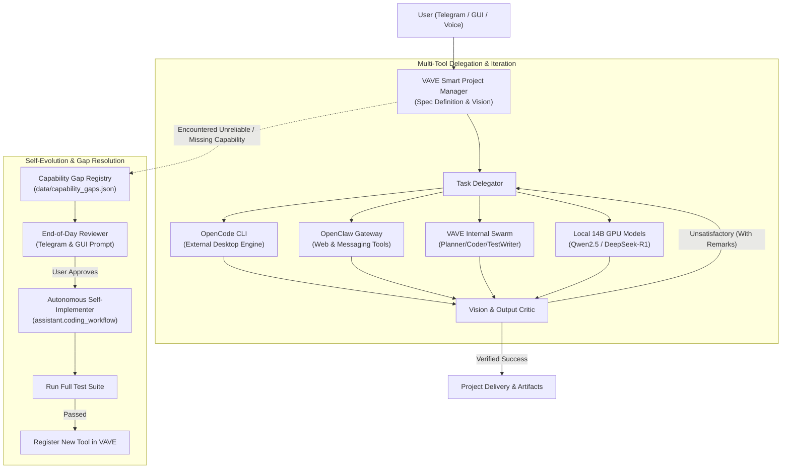

# VAVE Project Powerhouse & Self-Evolution Plan

> **Next implementation source of truth:**
> [`docs/jarvis-autonomy-roadmap.md`](docs/jarvis-autonomy-roadmap.md).
> Existing phases below record completed foundation work; new autonomous-agent
> development follows roadmap Phase 0 onward.

This document is the single source of truth for transforming VAVE into an autonomous **Project Powerhouse & Self-Evolving AI Project Manager**.

---

## 1. Core Vision & Strategic Pivot

VAVE pivots from a passive voice listener into a **Smart AI Project Manager & Autonomous Software Engine**:
1. **Orchestrator & Manager ("Manager Mode")**:
   - Takes complex project goals, defines an uncompromising **Vision Spec** (acceptance criteria, deliverables, test commands).
   - Divides and delegates work across **all available coding engines**:
     - **Local GPU 14B Models (Qwen2.5-14B / DeepSeek-R1-14B)**: **Pure Manager Brains**. They plan, decompose, evaluate tests, critique, and route. They DO NOT write code.
     - **Antigravity** (`assistant/integrations/antigravity.py` / `agentapi.bat`): **Primary Coding Engine**. High limits, Google DeepMind models (Flash/Pro) for all feature and test writing.
     - **OpenCode** (`opencode-cli.exe`): **Restricted Paid Engine**. Reserved strictly for hyper-complex full-stack scaffolding.
     - **OpenClaw** (`moltbotden.cmd`): Web automation & messaging integrations.
   - **Iterative Critique Loop**: Inspects output against the Vision Spec. If unsatisfactory, loops back to the assigned AI tool with specific critical remarks and instructions until verified.
2. **Autonomous Capability Gap Discovery & Self-Evolution**:
   - When VAVE encounters an inability to perform a task reliably (missing API, lack of tool, unsupported CLI), it registers the gap in `data/capability_gaps.json`.
   - Formulates a technical feature blueprint to bridge the gap.
   - **End-of-Day (EOD) Review**: Pushes a concise permission prompt to the user via Telegram and Desktop GUI.
   - **Autonomous Self-Implementation**: Upon user approval, VAVE invokes its own coding workflow to code, test, verify, and register the new capability into itself.
3. **Telegram Control & Governance Hub**:
   - Direct project steering from configured paired Telegram chat.
   - Project progress alerts, interactive approval buttons, and EOD capability review.

---

## 2. Architecture Diagram

---

## 3. Implementation Status

### [x] Phase 1: Tool Harness & Gateway Integration (OpenCode + OpenClaw) - COMPLETE
- [x] OpenCode CLI integration (`assistant/integrations/opencode.py`).
- [x] OpenClaw / MoltbotDen CLI integration (`assistant/integrations/openclaw.py`).
- [x] Tool registration and capability tiering in `capabilities.py` and `ai_brain.py`.
- [x] Unit tests passing: `tests/test_opencode_integration.py` and `tests/test_openclaw_integration.py` (9/9 passed).

### [x] Phase 2: The Smart Project Manager (Delegation & Vision Critique Loop) - COMPLETE
- [x] Data structures: `VisionSpec`, `ManagerTask`, `EvaluationResult` (`assistant/project_manager/spec.py`).
- [x] Engine implementation: `ProjectManager` with `synthesize_spec`, `delegate_task`, `evaluate`, `run_managed_project` (`assistant/project_manager/manager.py`).
- [x] Tool registration: `manage_coding_project` added to `capabilities.py` (`coding.write`) and `ai_brain.py`.
- [x] Unit tests passing: `tests/test_project_manager.py` (10/10 passed).

### [x] Phase 3: Capability Gap Discovery & Self-Evolution Engine - COMPLETE
- [x] Registry & persistence: `CapabilityGap` dataclass, `record_capability_gap`, `list_capability_gaps` in `data/capability_gaps.json` (`assistant/self_evolution/gaps.py`).
- [x] End-of-Day Reviewer: `generate_eod_summary()`, `approve_gap()`, `reject_gap()` (`assistant/self_evolution/eod_reviewer.py`).
- [x] Autonomous implementer: `implement_capability()`, `implement_all_approved_gaps()` (`assistant/self_evolution/auto_implementer.py`).
- [x] Tool registration: `record_capability_gap`, `list_capability_gaps`, `approve_and_implement_gap` in `capabilities.py` and `ai_brain.py`.
- [x] Unit tests passing: `tests/test_self_evolution.py` (6/6 passed).

### [x] Phase 4: Telegram Mobile Command Center - COMPLETE
- [x] `/project <goal>`: Background execution of `ProjectManager` with live milestone and completion notifications.
- [x] `/status`: System health, GPU AI status, and pending capability gaps.
- [x] `/gaps`: Formatted EOD summary of unaddressed capability gaps.
- [x] `/approve_gap <id>` / `/approve_all_gaps`: Mobile approval triggering instant autonomous implementation.
- [x] `/reject_gap <id>`: Dismissal of proposed gaps.
- [x] Unit tests passing: `tests/test_telegram_project_commands.py` (2/2 passed).

### [x] Phase 5: GUI Project Manager Dashboard - COMPLETE
- [x] Built CustomTkinter component `gui/pages/projects_page.py`.
- [x] Integrated "Manager Mode" view (goal entry, cycle limit, live execution console).
- [x] Integrated "Capability Gaps & Evolution" view (pending gap cards with "Approve & Implement" and "Dismiss" buttons).
- [x] Wired navigation into `gui/app.py` and `gui/widgets/sidebar.py`.

### [x] Phase 6: Safety, Honesty & Concurrency Hardening - COMPLETE
- [x] Manager rejects failed engines, missing/escaping targets, destructive test commands, malformed reviewer JSON, and non-boolean approval claims.
- [x] Vision Specs bounded to 20 tasks; duplicate IDs normalized; evidence passed into critique; missing project roots fail before model/tool execution.
- [x] Emergency Stop checked between cycles and delegated tasks.
- [x] Windows `.cmd`/`.bat` launchers resolved to underlying executable, keeping model text out of `cmd.exe` parsing.
- [x] Capability implementation requires atomic `approved -> implementing` transition; pending and duplicate builds are denied.
- [x] Agent step exhaustion automatically records a redacted, de-duplicated capability gap for review.
- [x] Capability registry uses locked, fsynced atomic replacement and respects `VAVE_DATA_DIR`.
- [x] Telegram serializes coding/evolution jobs and reports configured model instead of hardcoded GPU claims.
- [x] GUI worker completion uses `gui.ui_queue`, never Tk calls from worker threads.

### [x] Phase 7: Consequence-Free Dry Run / Rehearsal - COMPLETE
- [x] Request, process, CLI (`--dry-run`), persistent config, and voice/text controls.
- [x] Guard simulates sensitive, destructive, unknown, and outward actions while allowing safe reads.
- [x] Hard-denies remain blocked; control-plane approvals and secret resolution are skipped.
- [x] Coding workflow and Manager Mode produce plans without engines, writes, tests, or commits.
- [x] Self-evolution preserves registry state; Workspace writes, Home controls, and remote file mutations simulate at service boundaries.
- [x] Redacted audit/timeline evidence and dedicated regression coverage.

---

## 4. Test Suite Summary
- **OpenCode & OpenClaw**: 9/9 passed.
- **Antigravity + safe process launchers**: 6/6 passed.
- **Project Manager**: 20/20 passed.
- **Self-Evolution**: 14/14 passed.
- **Telegram Gateway**: 4/4 passed.
- **Security Capability Coverage**: 43/43 passed (`tests/test_report_security.py`).
- **Full suite**: 1111 tests run successfully, including 1 skipped (`python -m unittest discover -s tests`).
- **Smoke Test**: 11/11 passed (`python main.py --smoke-test`).
- **Syntax**: 0 errors (`python -m compileall -q main.py assistant gui vave_gui.py`).
